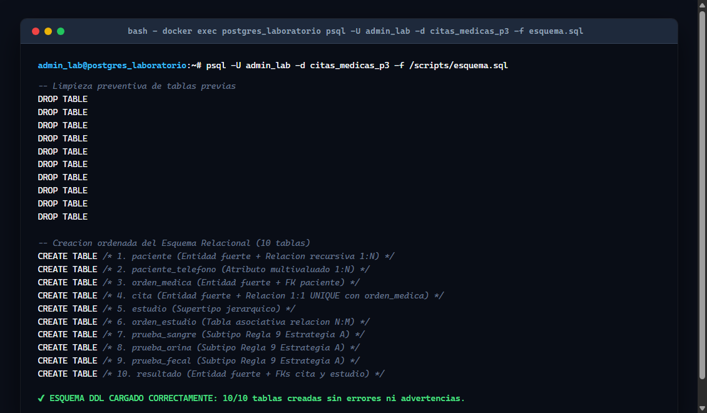
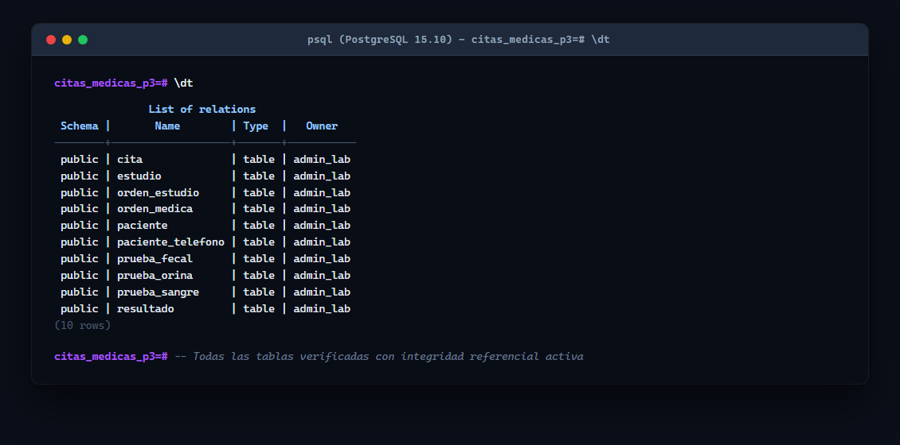
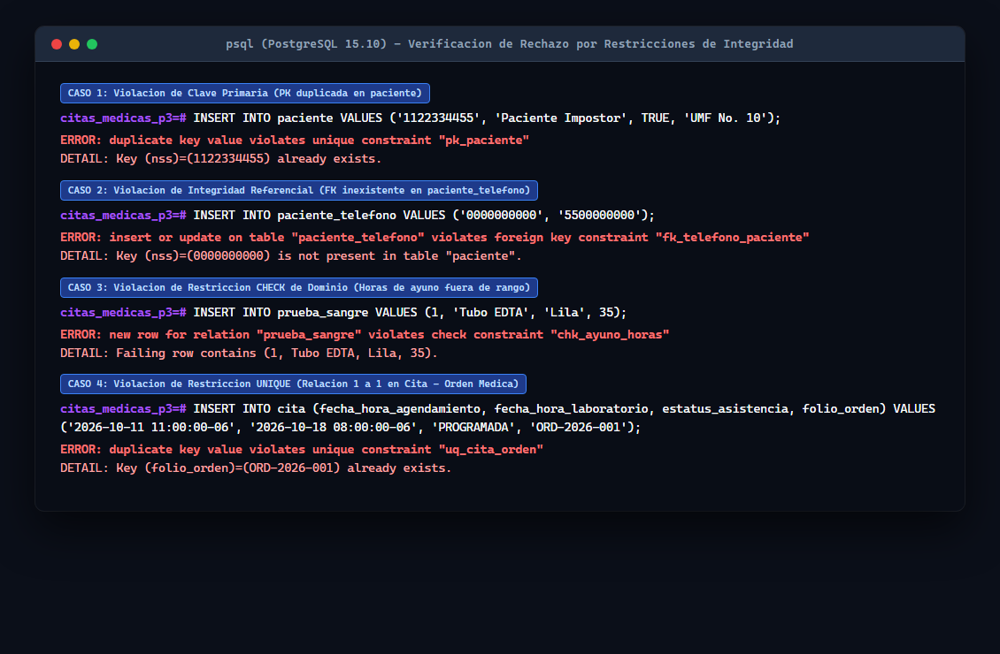

# Evidencias de Ejecución y Rechazo de Restricciones (PostgreSQL)

## 1. Verificación del Contenedor y Creación de Base de Datos Vacía
* **Contenedor:** `postgres_laboratorio` (Imagen `postgres:15-alpine`)
* **Base de datos creada:** `citas_medicas_p3`

```sql
CREATE DATABASE citas_medicas_p3;
-- Salida: CREATE DATABASE
```

### Comprobación de Base Vacía (`\dt` inicial)
```text
citas_medicas_p3=# \dt
Did not find any relations.
```

---

## 2. Ejecución del Esquema DDL (`esquema.sql`) sin Errores

```text
DROP TABLE
CREATE TABLE
CREATE TABLE
CREATE TABLE
CREATE TABLE
CREATE TABLE
CREATE TABLE
CREATE TABLE
CREATE TABLE
CREATE TABLE
```



### Listado de Tablas Creadas (`\dt` final)
```text
               List of relations
 Schema |       Name        | Type  |   Owner   
--------+-------------------+-------+-----------
 public | cita              | table | admin_lab
 public | estudio           | table | admin_lab
 public | orden_estudio     | table | admin_lab
 public | orden_medica      | table | admin_lab
 public | paciente          | table | admin_lab
 public | paciente_telefono | table | admin_lab
 public | prueba_fecal      | table | admin_lab
 public | prueba_orina      | table | admin_lab
 public | prueba_sangre     | table | admin_lab
 public | resultado         | table | admin_lab
(10 rows)
```



---

## 3. Pruebas de Rechazo por Violación de Restricciones (Evidencia Obligatoria)

### Caso 1: Violación de Clave Primaria (PK duplicada en `paciente`)
```sql
INSERT INTO paciente (nss, nombre, estatus_vigencia, unidad_medica_adscripcion)
VALUES ('1122334455', 'Paciente Impostor', TRUE, 'UMF No. 10');
```
**Mensaje de error devuelto por PostgreSQL:**
```text
ERROR: duplicate key value violates unique constraint "pk_paciente"
DETAIL: Key (nss)=(1122334455) already exists.
```

---

### Caso 2: Violación de Integridad Referencial (FK inexistente en `paciente_telefono`)
```sql
INSERT INTO paciente_telefono (nss, telefono)
VALUES ('0000000000', '5500000000');
```
**Mensaje de error devuelto por PostgreSQL:**
```text
ERROR: insert or update on table "paciente_telefono" violates foreign key constraint "fk_telefono_paciente"
DETAIL: Key (nss)=(0000000000) is not present in table "paciente".
```

---

### Caso 3: Violación de Restricción CHECK de Dominio (Horas de ayuno inválidas en `prueba_sangre`)
```sql
INSERT INTO prueba_sangre (id_estudio, tipo_tubo, color_tapon, ayuno_horas)
VALUES (1, 'Tubo EDTA', 'Lila', 35);
```
**Mensaje de error devuelto por PostgreSQL:**
```text
ERROR: new row for relation "prueba_sangre" violates check constraint "chk_ayuno_horas"
DETAIL: Failing row contains (1, Tubo EDTA, Lila, 35).
```

---

### Caso 4: Violación de Restricción UNIQUE (Relación 1 a 1 entre `cita` y `orden_medica`)
```sql
INSERT INTO cita (fecha_hora_agendamiento, fecha_hora_laboratorio, estatus_asistencia, folio_orden)
VALUES ('2026-10-11 11:00:00-06', '2026-10-18 08:00:00-06', 'PROGRAMADA', 'ORD-2026-001');
```
**Mensaje de error devuelto por PostgreSQL:**
```text
ERROR: duplicate key value violates unique constraint "uq_cita_orden"
DETAIL: Key (folio_orden)=(ORD-2026-001) already exists.
```


