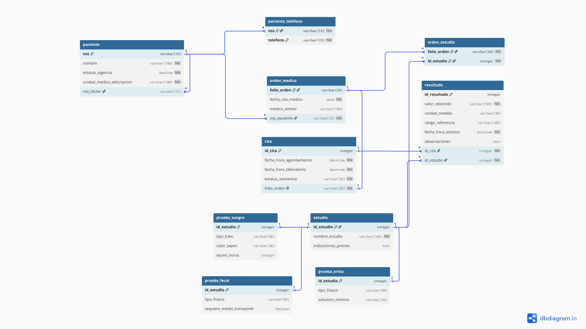

# Ejercicios 3, 4 y 5: Reglas de Transformación EER a Relacional
## Proyecto Propio: Citas Médicas y Laboratorio

---

## 1. Diagrama Relacional Resultante

---

## 2. Ejercicio 3: Reglas de Transformación Básicas

### Regla 1: Transformación de Entidades Fuertes
Cada entidad fuerte del modelo EER se convirtió en una tabla relacional independiente:
* `PACIENTE` -> Tabla `paciente`: Clave primaria `nss VARCHAR(15)`, columnas `nombre`, `estatus_vigencia`, `unidad_medica_adscripcion`, `nss_titular`.
* `ORDEN_MEDICA` -> Tabla `orden_medica`: Clave primaria `folio_orden VARCHAR(20)`, columnas `fecha_cita_medico`, `medico_emisor`, `nss_paciente`.
* `ESTUDIO` -> Tabla `estudio`: Clave primaria `id_estudio SERIAL`, columnas `nombre_estudio UNIQUE`, `indicaciones_previas`.
* `CITA` -> Tabla `cita`: Clave primaria `id_cita SERIAL`, columnas `fecha_hora_agendamiento`, `fecha_hora_laboratorio`, `estatus_asistencia`, `folio_orden`.
* `RESULTADO` -> Tabla `resultado`: Clave primaria `id_resultado SERIAL`, columnas `valor_obtenido`, `unidad_medida`, `rango_referencia`, `fecha_hora_emision`, `observaciones`, `id_cita`, `id_estudio`.

### Regla 2: Descomposición de Atributos Compuestos
Los componentes atómicos de nombres y datos clínicos se normalizaron sin estructuras anidadas complejas.

### Regla 3: Atributos Multivaluados
* El atributo `telefono` de `PACIENTE` es multivaluado (un paciente puede contar con teléfono fijo, móvil de casa, etc.).
* **Transformación:** Se transformó en una tabla propia `paciente_telefono`.
  * Clave foránea: `nss` referenciando a `paciente(nss)`.
  * Columna de valor: `telefono VARCHAR(15)`.
  * Clave primaria compuesta: `PRIMARY KEY (nss, telefono)`.
  * Acción referencial: `ON DELETE CASCADE ON UPDATE CASCADE`.

---

## 3. Ejercicio 4: Transformación de Relaciones

### Regla 4: Relaciones Uno a Muchos ($1:N$)
* **Relación `PRESENTA` (`paciente` $1 \rightarrow N$ `orden_medica`):**
  * La PK de `paciente` (`nss`) se propaga como FK a `orden_medica` (`nss_paciente`). Es `NOT NULL` con acción referencial `ON DELETE RESTRICT ON UPDATE CASCADE`.
* **Relación `ARROJA` (`cita` $1 \rightarrow N$ `resultado`):**
  * La PK de `cita` (`id_cita`) se propaga como FK a la tabla `resultado`. Es `NOT NULL` con `ON DELETE CASCADE`. Adicionalmente, `resultado` referencia a `estudio(id_estudio)` para asociar el analito.
* **Relación Recursiva `depende_de` (`paciente` $1 \rightarrow N$ `paciente`):**
  * La PK `nss` se propaga a la misma tabla como `nss_titular` (admite nulos para titulares independientes).

### Regla 5: Relaciones Muchos a Muchos ($N:M$)
* **Relación `CONTIENE` (`orden_medica` $N \leftrightarrow M$ `estudio`):**
  * Se transforma en la tabla asociativa `orden_estudio`.
  * Claves foráneas: `folio_orden` referenciando a `orden_medica` e `id_estudio` referenciando a `estudio`.
  * Clave primaria compuesta: `PRIMARY KEY (folio_orden, id_estudio)`.

### Regla 6: Relaciones Uno a Uno ($1:1$)
* **Relación `GENERA` (`orden_medica` $1 \leftrightarrow 1$ `cita`):**
  * **Estrategia elegida:** Estrategia 1 (Propagación de clave con restricción `UNIQUE`).
  * **Justificación:** Una orden médica existe previamente en consulta. Al momento de programar en laboratorio, se propaga `folio_orden` a `cita` con restricción `UNIQUE` y `NOT NULL`. Esto asegura la correspondencia unívoca.

---

## 4. Ejercicio 5: Jerarquías y Especializaciones

### Regla 9: Jerarquía de Especialización de `ESTUDIO`
* **Tipo de Jerarquía:** Disjunta ($d$) y Total ($t$).
* **Estrategia seleccionada:** **Estrategia A (Tabla por supertipo y por subtipo)**.
* **Justificación:** Los subtipos tienen atributos propios dispares (`color_tapon` en sangre, `volumen_minimo` en orina, `requiere_medio_transporte` en muestras fecales). La Estrategia A previene columnas nulas y mantiene integridad con la tabla asociativa `orden_estudio`.
* **Tablas resultantes:**
  * Supertipo: `estudio (id_estudio, nombre_estudio, indicaciones_previas)`.
  * Subtipos:
    * `prueba_sangre (id_estudio PK/FK, tipo_tubo, color_tapon, ayuno_horas)`.
    * `prueba_orina (id_estudio PK/FK, tipo_frasco, volumen_minimo)`.
    * `prueba_fecal (id_estudio PK/FK, tipo_frasco, requiere_medio_transporte)`.
