# Práctica 7 y 8: Álgebra Relacional sobre Datos Reales
## Proyecto Propio: Sistema de Citas Médicas y Laboratorio Clínico (CitasMed)
**Equipo de Trabajo:** Ian Andrew Aguilar Garcia, Kevin Edú Vega Treviño, Alondra Quintanar Sanchez, Joel Sanchez Palma.  
**Materia:** Bases de Datos (ISC / IIA - ESCOM IPN)  
**Semestre:** 2027-1

---

## Introducción al Álgebra Relacional en CitasMed

El álgebra relacional es un lenguaje formal de consulta procedural que opera sobre relaciones (tablas) produciendo nuevas relaciones sin modificar los datos subyacentes. En el contexto de nuestro sistema de laboratorio clínico *CitasMed*, permite especificar formalmente la lógica de recuperación de pacientes, muestras hematológicas, órdenes médicas y resultados diagnósticos antes de su traducción física al optimizador de consultas de PostgreSQL.

---

## Ejercicio 2.1. Sus Datos en RelaX

Para la experimentación formal e interactiva de las consultas en el evaluador **RelaX (Relational Algebra Calculator)** desarrollado por la Universidad de Innsbruck (*dbis-uibk.github.io/relax*), se construyó el script automatizado:

* **Script generador:** `relax/exportar-grupo.py`
* **Archivo de grupo:** `relax/grupo.txt`
* **Grupo generado:** `group: CitasMed_Laboratorio`

El script exporta un subconjunto consistente de **117 tuplas distribuidas en las 10 tablas del esquema**, conservando de manera estricta la integridad referencial (claves primarias y foráneas). Puede cargarse directamente en la pestaña **Editor de Grupo** de RelaX para ejecutar cualquiera de las expresiones algebraicas listadas a continuación.

---

## Ejercicio 2.2. Consultas en Álgebra Relacional

A continuación se presentan las 13 consultas formales cubriendo exhaustivamente todos los operadores fundamentales, derivados y extendidos del álgebra relacional requeridos por la rúbrica oficial.

---

### Consulta 1: Selección Simple (σ)
* **Pregunta del dominio:** ¿Cuáles son los derechohabientes con vigencia de derechos activa en el sistema?
* **Demostración requerida:** Filtrado de filas bajo una condición booleana atómica.
* **Expresión en Álgebra Relacional:**

$$\sigma_{\text{estatus}\textunderscore\text{vigencia} = \text{true}}(\text{paciente})$$

* **Sintaxis RelaX:**
```text
sigma estatus_vigencia = 'true' (paciente)
```
* **Captura de RelaX (Árbol y Resultado):**

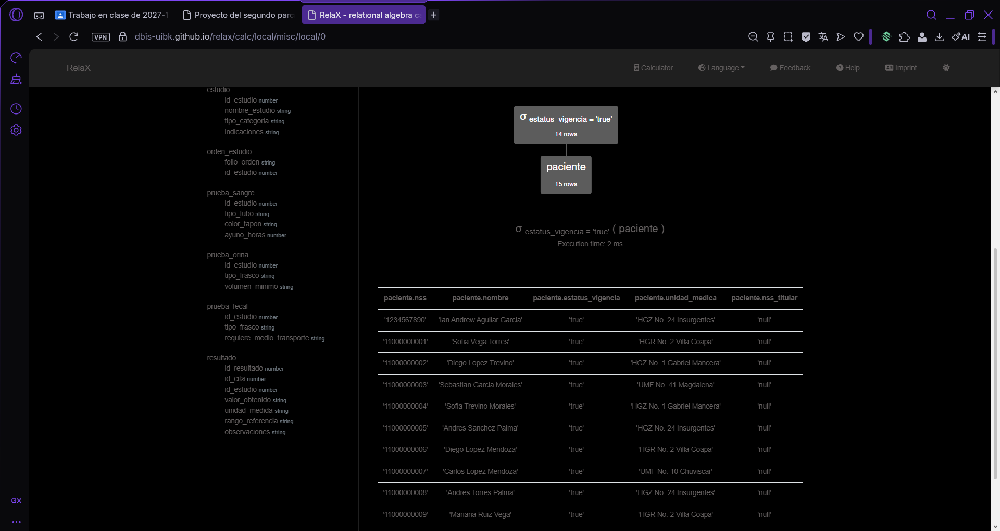

* **Árbol Sintáctico Relacional:**
```text
      σ (estatus_vigencia = 'true')
                   │
               paciente
```
* **Consulta SQL Equivalente:**
```sql
SELECT nss, nombre, unidad_medica_adscripcion
FROM paciente
WHERE estatus_vigencia = true;
```
* **Análisis de Ejecución:** El operador $\sigma$ examina tupla por tupla la relación `paciente`, reteniendo únicamente aquellas cuyo predicado de vigencia es verdadero y descartando a los derechohabientes suspendidos temporalmente.

---

### Consulta 2: Proyección Simple (π)
* **Pregunta del dominio:** ¿Cuáles son las distintas unidades médicas de adscripción registradas en el catálogo de pacientes?
* **Demostración requerida:** Filtrado vertical de columnas y eliminación de tuplas duplicadas.
* **Expresión en Álgebra Relacional:**

$$\pi_{\text{unidad}\textunderscore\text{medica}\textunderscore\text{adscripcion}}(\text{paciente})$$

* **Sintaxis RelaX:**
```text
pi unidad_medica (paciente)
```
* **Captura de RelaX (Árbol y Resultado):**

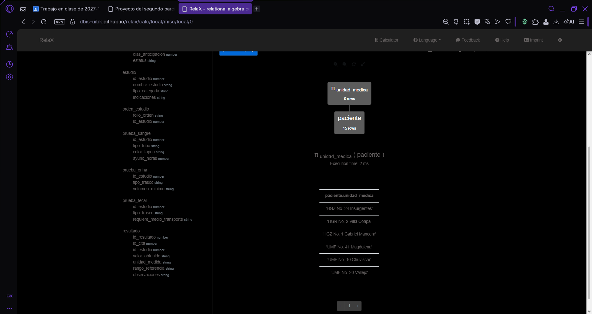

* **Árbol Sintáctico Relacional:**
```text
        π (unidad_medica)
                │
            paciente
```
* **Consulta SQL Equivalente:**
```sql
SELECT DISTINCT unidad_medica_adscripcion
FROM paciente;
```
* **Análisis de Ejecución:** En el álgebra relacional pura, las relaciones son conjuntos matemáticos sin duplicados; por ende, $\pi$ elimina implícitamente las repeticiones al proyectar un único atributo. En SQL relacional, esto corresponde estrictamente a `SELECT DISTINCT`.

---

### Consulta 3: Composición de Selección y Proyección (π ∘ σ)
* **Pregunta del dominio:** ¿Cuáles son las pruebas de sangre que requieren 8 o más horas de ayuno estricto?
* **Demostración requerida:** Filtrado simultáneo horizontal y vertical con restricción paramétrica.
* **Expresión en Álgebra Relacional:**

$$\pi_{\text{id}\textunderscore\text{estudio},\, \text{tipo}\textunderscore\text{tubo},\, \text{color}\textunderscore\text{tapon}}(\sigma_{\text{ayuno}\textunderscore\text{horas} \ge 8}(\text{prueba}\textunderscore\text{sangre}))$$

* **Sintaxis RelaX:**
```text
pi id_estudio, tipo_tubo, color_tapon (sigma ayuno_horas >= 8 (prueba_sangre))
```
* **Captura de RelaX (Árbol y Resultado):**

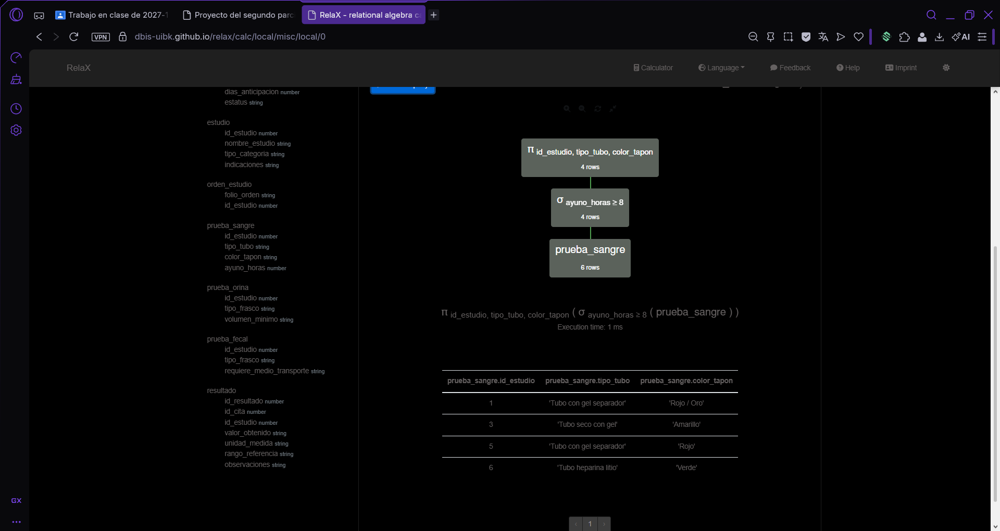

* **Árbol Sintáctico Relacional:**
```text
    π (id_estudio, tipo_tubo, color_tapon)
                       │
            σ (ayuno_horas >= 8)
                       │
                 prueba_sangre
```
* **Consulta SQL Equivalente:**
```sql
SELECT id_estudio, tipo_tubo, color_tapon
FROM prueba_sangre
WHERE ayuno_horas >= 8;
```
* **Análisis de Ejecución:** La selección se evalúa en primer término en el árbol sintáctico (empuje de predicados), reduciendo la cardinalidad de la relación antes de que la proyección descarte los metadatos irrelevantes.

---

### Consulta 4: Unión de Conjuntos (∪)
* **Pregunta del dominio:** ¿Cuáles son todos los identificadores de derechohabientes que fungen como titulares o como beneficiarios?
* **Demostración requerida:** Compatibilidad de unión (mismo grado y dominios compatibles de atributos).
* **Expresión en Álgebra Relacional:**

$$T_1 \leftarrow \pi_{\text{nss}}(\sigma_{\text{nss}\textunderscore\text{titular} = \text{null}}(\text{paciente}))$$

$$T_2 \leftarrow \pi_{\text{nss}\textunderscore\text{titular}}(\sigma_{\text{nss}\textunderscore\text{titular} \neq \text{null}}(\text{paciente}))$$

$$\text{Resultado} = T_1 \cup T_2$$

* **Sintaxis RelaX:**
```text
(pi nss (sigma nss_titular = 'null' (paciente)))
union
(pi nss_titular (sigma nss_titular != 'null' (paciente)))
```
* **Captura de RelaX (Árbol y Resultado):**

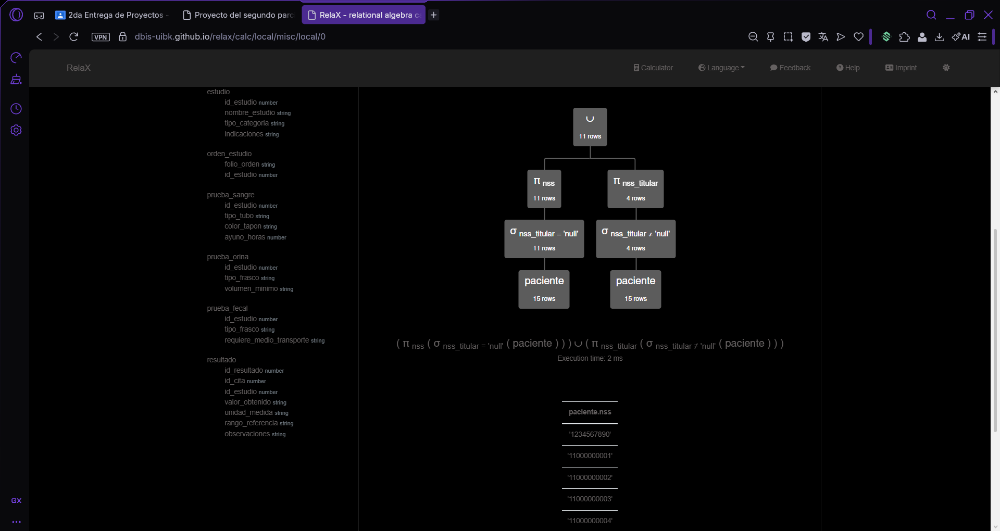

* **Árbol Sintáctico Relacional:**
```text
                  ∪ (Union)
                 ┌───┴───┐
                 │       │
            π (nss)    π (nss_titular)
                 │       │
       σ (nss_null)    σ (nss_not_null)
                 │       │
          paciente    paciente
```
* **Consulta SQL Equivalente:**
```sql
SELECT nss, nombre, 'TITULAR' AS tipo_derechohabiente
FROM paciente
WHERE nss_titular IS NULL
UNION
SELECT nss, nombre, 'BENEFICIARIO' AS tipo_derechohabiente
FROM paciente
WHERE nss_titular IS NOT NULL;
```
* **Análisis de Ejecución:** Ambas sub-relaciones poseen grado 1 y dominio idéntico (`VARCHAR(15)` correspondiente al formato del Número de Seguridad Social), cumpliendo con la regla estricta de compatibilidad de unión.

---

### Consulta 5: Diferencia de Conjuntos (−)
* **Pregunta del dominio:** ¿Qué derechohabientes registrados no tienen ningún número telefónico de contacto?
* **Demostración requerida:** Sustracción relacional para identificar elementos del universo sin correspondencia.
* **Expresión en Álgebra Relacional:**

$$T_{\text{todos}} \leftarrow \pi_{\text{nss}}(\text{paciente})$$

$$T_{\text{con}\textunderscore\text{tel}} \leftarrow \pi_{\text{nss}}(\text{paciente}\textunderscore\text{telefono})$$

$$\text{Resultado} = T_{\text{todos}} - T_{\text{con}\textunderscore\text{tel}}$$

* **Sintaxis RelaX:**
```text
(pi nss (paciente)) - (pi nss (paciente_telefono))
```
* **Captura de RelaX (Árbol y Resultado):**

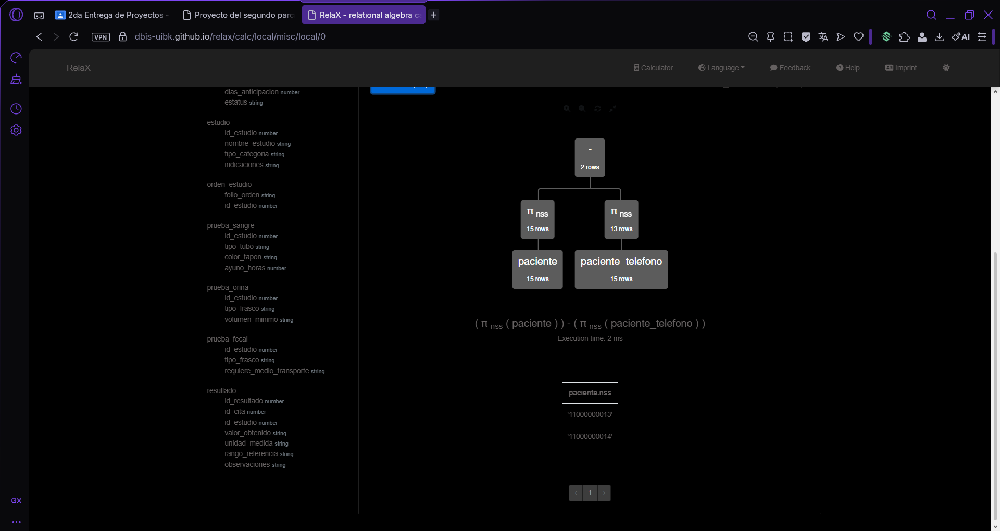

* **Árbol Sintáctico Relacional:**
```text
                  - (Difference)
                 ┌───┴───┐
                 │       │
            π (nss)    π (nss)
                 │       │
          paciente    paciente_telefono
```
* **Consulta SQL Equivalente:**
```sql
SELECT nss, nombre
FROM paciente
EXCEPT
SELECT p.nss, p.nombre
FROM paciente p
JOIN paciente_telefono t ON p.nss = t.nss;
```
* **Análisis de Ejecución:** Resta al conjunto universal de derechohabientes aquellos que poseen al menos un registro en la tabla de teléfonos, aislando a los pacientes vulnerables que no pueden ser contactados para recordar citas.

---

### Consulta 6: Intersección de Conjuntos (∩)
* **Pregunta del dominio:** ¿Qué estudios clínicos fueron prescritos simultáneamente en las órdenes ORD-2026-0001 y ORD-2026-0003?
* **Demostración requerida:** Compatibilidad de tipos y preservación únicamente de tuplas compartidas.
* **Expresión en Álgebra Relacional:**

$$E_1 \leftarrow \pi_{\text{id}\textunderscore\text{estudio}}(\sigma_{\text{folio}\textunderscore\text{orden} = \text{'ORD-2026-0001'}}(\text{orden}\textunderscore\text{estudio}))$$

$$E_2 \leftarrow \pi_{\text{id}\textunderscore\text{estudio}}(\sigma_{\text{folio}\textunderscore\text{orden} = \text{'ORD-2026-0003'}}(\text{orden}\textunderscore\text{estudio}))$$

$$\text{Resultado} = E_1 \cap E_2$$

* **Sintaxis RelaX:**
```text
(pi id_estudio (sigma folio_orden = 'ORD-2026-0001' (orden_estudio)))
intersect
(pi id_estudio (sigma folio_orden = 'ORD-2026-0003' (orden_estudio)))
```
* **Captura de RelaX (Árbol y Resultado):**

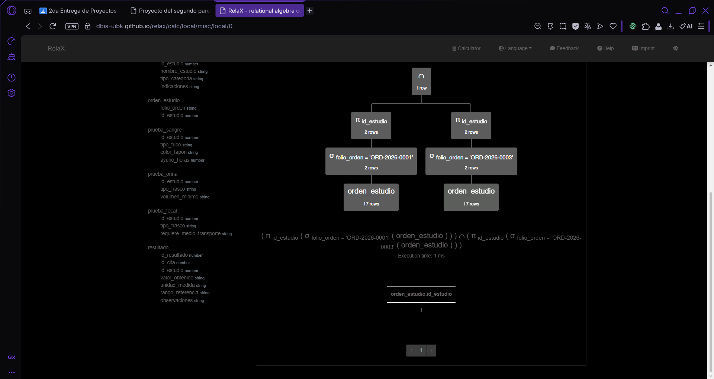

* **Árbol Sintáctico Relacional:**
```text
                  ∩ (Intersect)
                 ┌───┴───┐
                 │       │
       π (id_estudio)  π (id_estudio)
                 │       │
     σ (ORD-0001)      σ (ORD-0003)
                 │       │
        orden_estudio  orden_estudio
```
* **Consulta SQL Equivalente:**
```sql
SELECT id_estudio
FROM orden_estudio
WHERE folio_orden = 'ORD-2026-0001'
INTERSECT
SELECT id_estudio
FROM orden_estudio
WHERE folio_orden = 'ORD-2026-0003';
```
* **Análisis de Ejecución:** La intersección es un operador derivado ($A \cap B = A - (A - B)$). Retorna el estudio clínico `1` (*Química Sanguínea 6 Elementos*), que fue prescrito en ambos folios médicos.

---

### Consulta 7: Producto Cartesiano (×)
* **Pregunta del dominio:** ¿Cuál es la matriz combinatoria completa entre el catálogo de estudios de orina y los tipos de recipientes recolectores de pruebas fecales?
* **Demostración requerida:** Demostrar por qué casi nunca se usa sin filtrar (explosión combinatoria de tuplas).
* **Expresión en Álgebra Relacional:**

$$U \leftarrow \pi_{\text{nombre}\textunderscore\text{estudio}}(\text{estudio} \bowtie \text{prueba}\textunderscore\text{orina})$$

$$F \leftarrow \pi_{\text{tipo}\textunderscore\text{frasco}}(\text{prueba}\textunderscore\text{fecal})$$

$$\text{Resultado} = U \times F$$

* **Sintaxis RelaX:**
```text
(pi nombre_estudio (estudio join prueba_orina))
cross join
(pi tipo_frasco (prueba_fecal))
```
* **Captura de RelaX (Árbol y Resultado):**

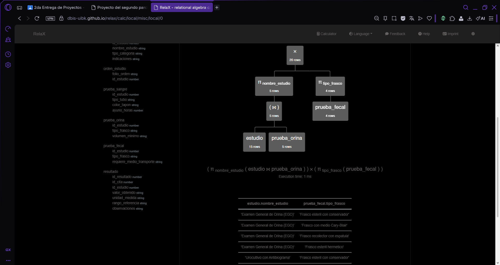

* **Árbol Sintáctico Relacional:**
```text
                   × (Cross Product)
                 ┌────────┴────────┐
                 │                 │
         π (nombre_estudio)    π (tipo_frasco)
                 │                 │
            ⋈ (Natural)        prueba_fecal
           ┌─────┴─────┐
        estudio    prueba_orina
```
* **Consulta SQL Equivalente:**
```sql
SELECT e.nombre_estudio, pf.tipo_frasco
FROM estudio e
JOIN prueba_orina po ON e.id_estudio = po.id_estudio
CROSS JOIN (SELECT DISTINCT tipo_frasco FROM prueba_fecal) pf;
```
* **Análisis de Ejecución:** Si $U$ tiene $m=5$ estudios y $F$ tiene $n=4$ tipos de frascos, el resultado produce $m \times n = 20$ tuplas sintéticas sin ningún significado clínico intrínseco. Esto evidencia formalmente por qué el producto cartesiano solo es viable como operador primitivo base sobre el cual se construyen las reuniones restringidas (Theta-Join).

---

### Consulta 8: Reunión Natural / Equi-Join (⋈)
* **Pregunta del dominio:** ¿Cuál es el nombre del derechohabiente y el médico emisor de cada orden médica expedida?
* **Demostración requerida:** Qué filas se pierden y cuáles se conservan en la correspondencia de claves.
* **Expresión en Álgebra Relacional:**

$$\pi_{\text{nss},\, \text{nombre},\, \text{folio}\textunderscore\text{orden},\, \text{medico}\textunderscore\text{emisor}}(\text{paciente} \bowtie_{\text{paciente.nss} = \text{orden}\textunderscore\text{medica.nss}\textunderscore\text{paciente}} \text{orden}\textunderscore\text{medica})$$

* **Sintaxis RelaX:**
```text
pi nss, nombre, folio_orden, medico_emisor (
  paciente join (rho nss_paciente->nss orden_medica)
)
```
* **Captura de RelaX (Árbol y Resultado):**

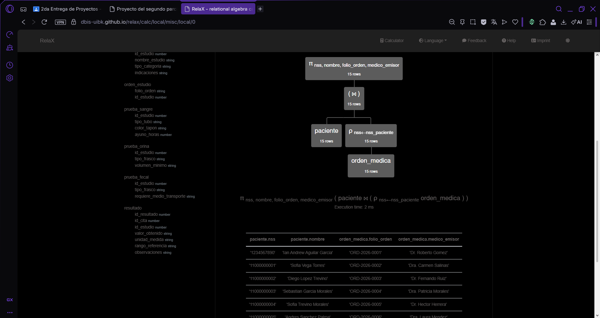

* **Árbol Sintáctico Relacional:**
```text
      π (nss, nombre, folio_orden, medico_emisor)
                         │
                     ⋈ (Natural Join)
                   ┌─────┴─────┐
               paciente    ρ (nss_paciente->nss)
                               │
                          orden_medica
```
* **Consulta SQL Equivalente:**
```sql
SELECT p.nss, p.nombre, o.folio_orden, o.medico_emisor, o.fecha_cita_medico
FROM paciente p
JOIN orden_medica o ON p.nss = o.nss_paciente;
```
* **Análisis de Filas:** Se conservan exactamente las tuplas donde existe una orden médica válida asociada a un paciente existente. Si un derechohabiente no tiene ninguna orden generada, sus datos no aparecen en la relación resultante (se descartan).

---

### Consulta 9: Reunión Theta (⋈_θ)
* **Pregunta del dominio:** ¿Qué pares de estudios sanguíneos tienen horas de ayuno distintas, ordenados para comparar el de mayor exigencia contra el de menor requerimiento?
* **Demostración requerida:** Condición de unión basada en una desigualdad ($>$) en lugar de igualdad.
* **Expresión en Álgebra Relacional:**

$$\text{Resultado} = \rho_{A}(\text{prueba}\textunderscore\text{sangre}) \bowtie_{A.\text{ayuno}\textunderscore\text{horas} > B.\text{ayuno}\textunderscore\text{horas}} \rho_{B}(\text{prueba}\textunderscore\text{sangre})$$

* **Sintaxis RelaX:**
```text
prueba_sangre join prueba_sangre.ayuno_horas > ps2.ayuno_horas (rho ps2 prueba_sangre)
```
* **Captura de RelaX (Árbol y Resultado):**

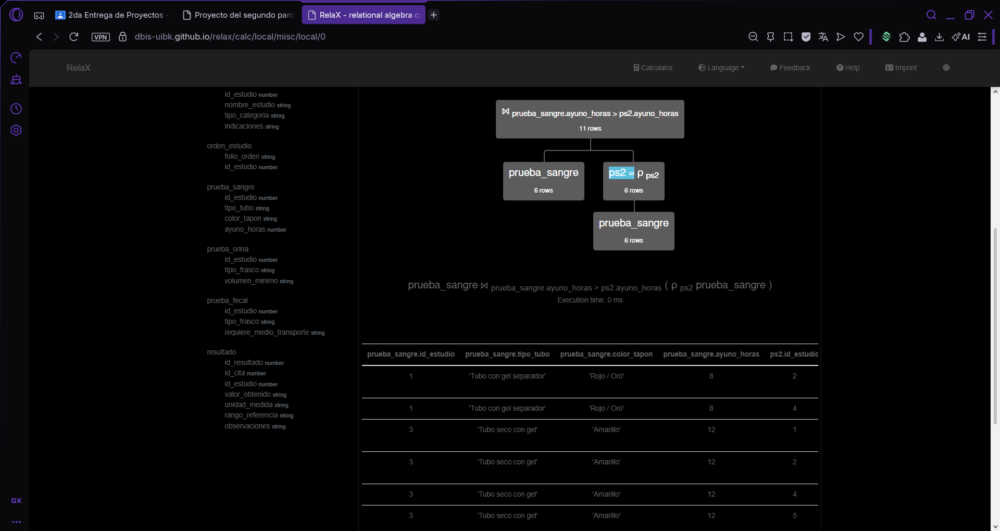

* **Árbol Sintáctico Relacional:**
```text
              ⋈_θ (ayuno_horas > ps2.ayuno_horas)
                   ┌──────────┴──────────┐
              prueba_sangre          ρ (ps2)
                                         │
                                   prueba_sangre
```
* **Consulta SQL Equivalente:**
```sql
SELECT s1.id_estudio AS estudio_mayor_ayuno, s1.ayuno_horas AS ayuno_a,
       s2.id_estudio AS estudio_menor_ayuno, s2.ayuno_horas AS ayuno_b
FROM prueba_sangre s1
JOIN prueba_sangre s2 ON s1.ayuno_horas > s2.ayuno_horas;
```
* **Análisis de Filas:** Se emparejan estudios donde el ayuno del primero supera estrictamente al segundo (ej. Perfil Lipídico de 12 horas frente a Química Sanguínea de 8 horas, y ambos frente a Biometría Hemática de 0 horas). Se descartan todas las tuplas reflexivas ($s1 = s2$) y los pares simétricos menores.

---

### Consulta 10: Reunión Externa Izquierda (⟕)
* **Pregunta del dominio:** ¿Cuáles son todos los pacientes y sus números telefónicos, conservando a los pacientes que no tienen teléfono registrado?
* **Demostración requerida:** Preservación de tuplas incompletas mediante la introducción de nulos relacionales.
* **Expresión en Álgebra Relacional:**

$$\pi_{\text{paciente.nss},\, \text{nombre},\, \text{telefono}}(\text{paciente} \mathbin{⟕}_{\text{paciente.nss} = \text{paciente}\textunderscore\text{telefono.nss}} \text{paciente}\textunderscore\text{telefono})$$

* **Sintaxis RelaX:**
```text
pi nss, nombre, telefono (
  paciente left outer join paciente_telefono
)
```
* **Captura de RelaX (Árbol y Resultado):**

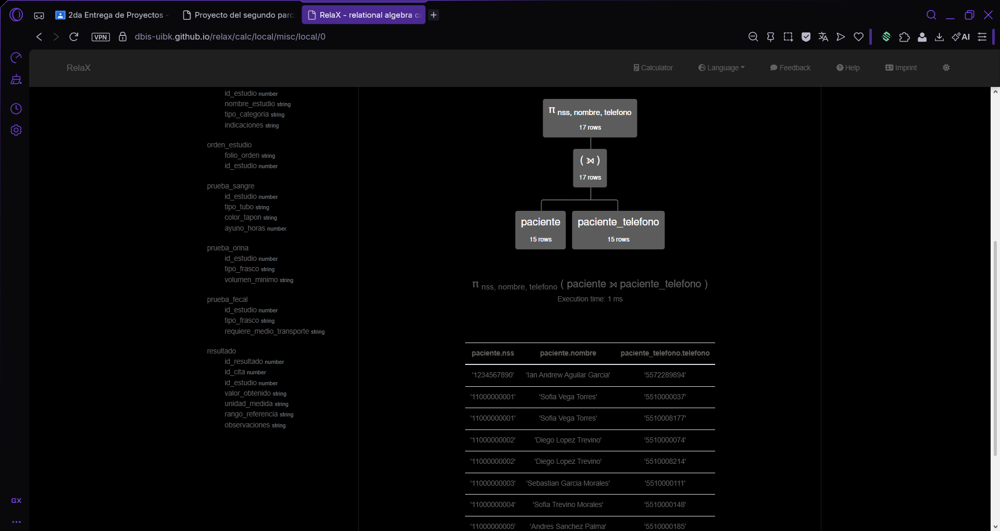

* **Árbol Sintáctico Relacional:**
```text
               π (nss, nombre, telefono)
                          │
             ⟕ (Left Outer Join)
                   ┌──────┴──────┐
               paciente    paciente_telefono
```
* **Consulta SQL Equivalente:**
```sql
SELECT p.nss, p.nombre, COALESCE(t.telefono, 'SIN TELEFONO REGISTRADO') AS telefono
FROM paciente p
LEFT JOIN paciente_telefono t ON p.nss = t.nss;
```
* **Análisis de Filas:** En la reunión interna clásica (Consulta 8), los pacientes sin teléfono son descartados. La reunión externa izquierda $\mathbin{⟕}$ garantiza que **el 100% de los pacientes se preserven en el resultado**, rellenando el atributo `telefono` con valores nulos para aquellos que carecen de número telefónico.

---

### Consulta 11: Agrupación y Agregación (γ)
* **Pregunta del dominio:** ¿Cuántas citas clínicas existen y cuál es el volumen operativo agrupado por estatus de asistencia?
* **Demostración requerida:** Generación de resúmenes estadísticos agrupados por un atributo categórico.
* **Expresión en Álgebra Relacional:**

$$\gamma_{\text{estatus};\, \text{count}(\text{id}\textunderscore\text{cita}) \rightarrow \text{total}\textunderscore\text{citas}}(\text{cita})$$

* **Sintaxis RelaX:**
```text
gamma estatus; count(id_cita)->total_citas (cita)
```
* **Captura de RelaX (Árbol y Resultado):**

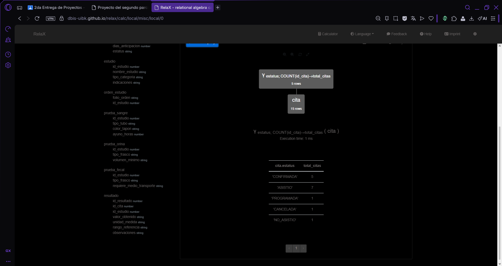

* **Árbol Sintáctico Relacional:**
```text
        γ (estatus; count(id_cita) -> total_citas)
                           │
                          cita
```
* **Consulta SQL Equivalente:**
```sql
SELECT estatus_asistencia, COUNT(id_cita) AS total_citas
FROM cita
GROUP BY estatus_asistencia
ORDER BY total_citas DESC;
```
* **Análisis de Ejecución:** El operador extendido $\gamma$ particiona la relación `cita` en subconjuntos disjuntos según el valor de `estatus_asistencia` y aplica la función agregada `count` sobre cada partición, produciendo una fila resumen por cada estatus operacional (*CONFIRMADA*, *ASISTIO*, *PROGRAMADA*, *CANCELADA*, *NO_ASISTIO*).

---

### Consulta 12: Agrupación Multitabla con Conteo (γ)
* **Pregunta del dominio:** ¿Cuántos estudios de laboratorio en total han sido prescritos por cada médico emisor?
* **Demostración requerida:** Composición de reunión con agrupación analítica.
* **Expresión en Álgebra Relacional:**

$$\gamma_{\text{medico}\textunderscore\text{emisor};\, \text{count}(\text{id}\textunderscore\text{estudio}) \rightarrow \text{total}\textunderscore\text{estudios}}(\text{orden}\textunderscore\text{medica} \bowtie \text{orden}\textunderscore\text{estudio})$$

* **Sintaxis RelaX:**
```text
gamma medico_emisor; count(id_estudio)->total_estudios (
  orden_medica join orden_estudio
)
```
* **Captura de RelaX (Árbol y Resultado):**

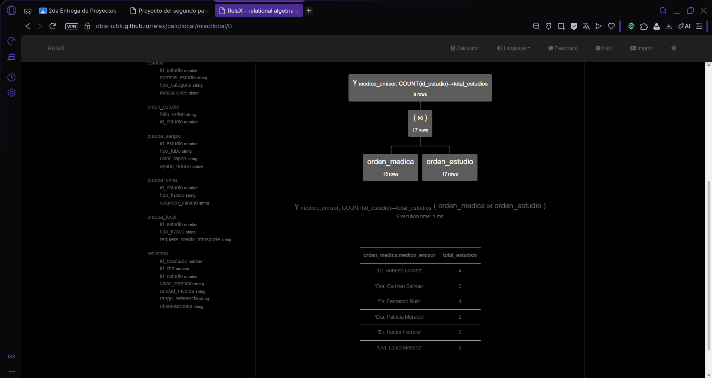

* **Árbol Sintáctico Relacional:**
```text
   γ (medico_emisor; count(id_estudio) -> total_estudios)
                             │
                     ⋈ (Natural Join)
                   ┌─────────┴─────────┐
             orden_medica        orden_estudio
```
* **Consulta SQL Equivalente:**
```sql
SELECT o.medico_emisor, COUNT(oe.id_estudio) AS total_estudios_prescritos
FROM orden_medica o
JOIN orden_estudio oe ON o.folio_orden = oe.folio_orden
GROUP BY o.medico_emisor
ORDER BY total_estudios_prescritos DESC;
```
* **Análisis de Ejecución:** Primero se evalúa la reunión relacional entre las órdenes médicas y los estudios incluidos en ellas; posteriormente, el operador $\gamma$ colapsa las filas sumando los estudios asignados por facultativo médico.

---

### Consulta 13: División Relacional (÷)
* **Pregunta del dominio:** ¿Qué órdenes médicas prescriben TODOS los estudios del catálogo de orina?
* **Demostración requerida:** Consulta que responde a una condición universal de «todos» mediante división formal.
* **Expresión en Álgebra Relacional:**

Sean:
$$R = \pi_{\text{folio}\textunderscore\text{orden},\, \text{id}\textunderscore\text{estudio}}(\text{orden}\textunderscore\text{estudio})$$

$$S = \pi_{\text{id}\textunderscore\text{estudio}}(\text{prueba}\textunderscore\text{orina})$$

La división formal $R \div S$ se define en álgebra primitiva como:
$$\text{Ordenes} \leftarrow \pi_{\text{folio}\textunderscore\text{orden}}(R)$$

$$\text{Combinaciones}\textunderscore\text{Posibles} \leftarrow \text{Ordenes} \times S$$

$$\text{Faltantes} \leftarrow \pi_{\text{folio}\textunderscore\text{orden}}(\text{Combinaciones}\textunderscore\text{Posibles} - R)$$

$$\text{Resultado} = \text{Ordenes} - \text{Faltantes}$$

* **Sintaxis RelaX:**
```text
(pi folio_orden (orden_estudio)) - (
  pi folio_orden (
    ((pi folio_orden (orden_estudio)) cross join (pi id_estudio (prueba_orina)))
    - (pi folio_orden, id_estudio (orden_estudio))
  )
)
```
* **Captura de RelaX (Árbol y Resultado):**

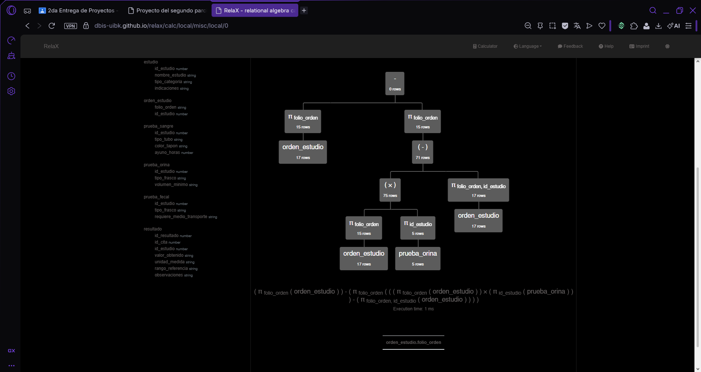

* **Árbol Sintáctico Relacional:**
```text
                              - (Division Result)
                     ┌────────────────┴────────────────┐
                     │                                 │
             π (folio_orden)                    π (folio_orden)
                     │                                 │
               orden_estudio                           - (Faltantes)
                                              ┌────────┴────────┐
                                              │                 │
                                              × (Cartesiano)   orden_estudio
                                         ┌────┴────┐
                                  π (folio)       π (id)
                                         │           │
                             orden_estudio     prueba_orina
```
* **Consulta SQL Equivalente:**
```sql
SELECT o.folio_orden, o.nss_paciente, o.medico_emisor
FROM orden_medica o
WHERE NOT EXISTS (
    SELECT po.id_estudio
    FROM prueba_orina po
    EXCEPT
    SELECT oe.id_estudio
    FROM orden_estudio oe
    WHERE oe.folio_orden = o.folio_orden
);
```
* **Análisis de Ejecución:** La división relacional identifica las órdenes $o$ tales que el conjunto de sus estudios $E(o)$ contiene como subconjunto a todos los estudios de orina ($S \subseteq E(o)$). Si en la base de datos no existe ninguna orden que prescriba simultáneamente los 5 estudios urológicos existentes, la consulta retorna el conjunto vacío ($\emptyset$), lo cual es matemáticamente exacto y demuestra el funcionamiento estricto del cuantificador universal.

---

## Ejercicio 2.3. El Álgebra del Proyecto Asignado (Sismos)

Se seleccionaron tres consultas analíticas representativas del sistema de monitoreo sísmico (*sismos_p4_5* / *Seismic Data System*):

---

### Consulta Sismos 1: Detección Espacio-Temporal de Alta Magnitud
* **Pregunta del negocio:** ¿Cuáles son los sismos registrados en los estados de Oaxaca o Guerrero con magnitud mayor o igual a 6.0 Richter?
* **Expresión en Álgebra Relacional:**

$$\pi_{\text{fecha}\textunderscore\text{hora},\, \text{magnitud},\, \text{estado}}(\sigma_{\text{magnitud} \ge 6.0 \,\land\, (\text{estado}='Oaxaca' \,\lor\, \text{estado}='Guerrero')}(\text{Fact}\textunderscore\text{Sismos} \bowtie \text{Dim}\textunderscore\text{Ubicacion}))$$

* **Sintaxis RelaX:**
```text
pi fecha_hora, magnitud, estado (
  sigma magnitud >= 6.0 and (estado = 'Oaxaca' or estado = 'Guerrero') (
    Fact_Sismos join Dim_Ubicacion
  )
)
```
* **Árbol Sintáctico:**
```text
         π (fecha_hora, magnitud, estado)
                         │
     σ (magnitud >= 6.0 ∧ (Oaxaca ∨ Guerrero))
                         │
                 ⋈ (Natural Join)
               ┌─────────┴─────────┐
          Fact_Sismos         Dim_Ubicacion
```
* **Operador que hace el trabajo pesado:** **La Selección ($\sigma$)**.
* **Justificación técnica:** En un almacén con millones de registros sísmicos, los terremotos $\ge 6.0$ representan menos del $0.5\%$ del total. Un optimizador relacional eficiente realiza **empuje de selección** (*pushdown*), filtrando la tabla de hechos antes de transferir páginas a la memoria para la reunión, evitando un costoso producto intermedio.

---

### Consulta Sismos 2: Densidad y Severidad Sísmica por Entidad Federativa
* **Pregunta del negocio:** ¿Cuántos sismos totales y cuál es la magnitud promedio registrada en cada estado de la República?
* **Expresión en Álgebra Relacional:**

$$\gamma_{\text{estado};\, \text{count}(\text{id}\textunderscore\text{sismo}) \rightarrow \text{total}\textunderscore\text{eventos},\, \text{avg}(\text{magnitud}) \rightarrow \text{promedio}\textunderscore\text{mag}}(\text{Fact}\textunderscore\text{Sismos} \bowtie \text{Dim}\textunderscore\text{Ubicacion})$$

* **Sintaxis RelaX:**
```text
gamma estado; count(id_sismo)->total_eventos, avg(magnitud)->promedio_mag (
  Fact_Sismos join Dim_Ubicacion
)
```
* **Árbol Sintáctico:**
```text
   γ (estado; count(id_sismo) -> total, avg(magnitud) -> prom)
                              │
                      ⋈ (Natural Join)
                    ┌─────────┴─────────┐
               Fact_Sismos         Dim_Ubicacion
```
* **Operador que hace el trabajo pesado:** **La Agrupación y Agregación ($\gamma$)**.
* **Justificación técnica:** La agregación sobre la tabla de hechos masiva exige construir una tabla hash en memoria (*HashAggregate*) o aplicar un algoritmo de ordenamiento externo (*Sort*) para agrupar los millones de sismos por la clave de estado antes de calcular los acumuladores estadísticos.

---

### Consulta Sismos 3: Auditoría de Sensores Inactivos en la Red
* **Pregunta del negocio:** ¿Qué estaciones sismológicas instaladas en la red de sensores no han registrado ningún evento sísmico?
* **Expresión en Álgebra Relacional:**

$$\pi_{\text{id}\textunderscore\text{estacion}}(\text{Dim}\textunderscore\text{Estacion}) - \pi_{\text{id}\textunderscore\text{estacion}}(\text{Fact}\textunderscore\text{Sismos})$$

* **Sintaxis RelaX:**
```text
(pi id_estacion (Dim_Estacion)) - (pi id_estacion (Fact_Sismos))
```
* **Árbol Sintáctico:**
```text
                     - (Difference)
                   ┌───────┴───────┐
                   │               │
           π (id_estacion)  π (id_estacion)
                   │               │
              Dim_Estacion    Fact_Sismos
```
* **Operador que hace el trabajo pesado:** **La Diferencia de Conjuntos ($-$)**.
* **Justificación técnica:** Para verificar la ausencia de tuplas (*Anti-Join*), el gestor debe realizar un escaneo completo de la dimensión y evaluar contra el índice de la tabla de hechos o mediante una tabla hash de exclusión (*Hash Anti-Join*), consumiendo tiempo de CPU proporcional al tamaño de la tabla más grande.

---

## Conclusiones y Resumen de Operadores

| # | Operador | Demostración Clave | Consulta CitasMed |
|---|---|---|---|
| 1 | σ (Selección) | Filtrado horizontal booleano | Pacientes con vigencia activa |
| 2 | π (Proyección) | Eliminación de duplicados y filtrado vertical | Clínicas de adscripción |
| 3 | π ∘ σ (Composición) | Selección previa a proyección | Pruebas de sangre con ≥ 8h de ayuno |
| 4 | ∪ (Unión) | Compatibilidad de tipos en esquemas disjuntos | Identificadores de titulares y beneficiarios |
| 5 | − (Diferencia) | Aislamiento de registros huérfanos | Pacientes sin teléfono |
| 6 | ∩ (Intersección) | Elementos concurrentes en múltiples conjuntos | Estudios compartidos entre órdenes |
| 7 | × (Cartesiano) | Explosión combinatoria m × n | Estudios de orina × frascos fecales |
| 8 | ⋈ (Natural) | Correspondencia exacta de clave foránea | Paciente y médico de órdenes médicas |
| 9 | ⋈_θ (Theta) | Emparejamiento por desigualdad estricta | Comparativa de horas de ayuno |
| 10 | ⟕ (Outer Join) | Preservación de tuplas incompletas con nulos | Listado universal de pacientes y teléfonos |
| 11 | γ (Agrupación) | Conteo operacional por estado de ciclo de vida | Citas por estatus de asistencia |
| 12 | γ (Agrupación) | Conteo sobre cardinalidad N:M | Estudios prescritos por médico |
| 13 | ÷ (División) | Cuantificación universal («todos») | Órdenes con todos los estudios de orina |