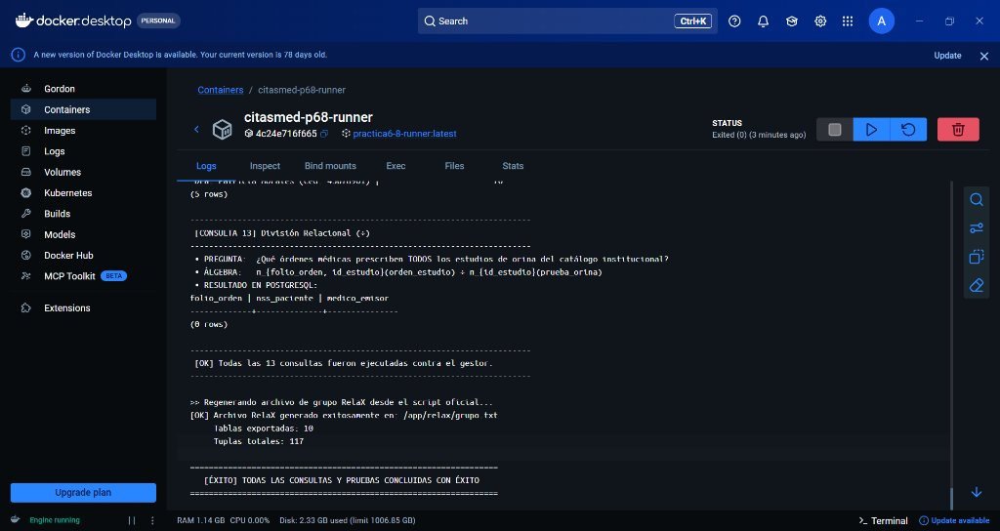

# Evidencias de Ejecución - Prácticas 6, 7 y 8
## Sistema Clínico y Laboratorio (CitasMed)

Este directorio organiza y documenta las evidencias gráficas y de ejecución solicitadas por la rúbrica oficial de la materia.

---

## 1. Consultas en Álgebra Relacional (RelaX)

Ubicación: `evidencias/relax/`  
Plataforma: [RelaX Calculator (dbis-uibk.github.io/relax)](https://dbis-uibk.github.io/relax/)  
Base de datos cargada: `group: CitasMed_Laboratorio` (117 tuplas sobre 10 tablas)

### Consultas Generales del Equipo (13 consultas)

| # | Operador | Pregunta Clínica Resuelta | Archivo de Evidencia |
|---|---|---|---|
| **01** | Selección (σ) | Pacientes con vigencia de derechos activa | [consulta-01.png](relax/consulta-01.png) |
| **02** | Proyección (π) | Clínicas de adscripción registradas | [consulta-02.png](relax/consulta-02.png) |
| **03** | Composición (π ∘ σ) | Pruebas de sangre con ayuno ≥ 8 horas | [consulta-03.png](relax/consulta-03.png) |
| **04** | Unión (∪) | Identificadores de titulares y beneficiarios | [consulta-04.png](relax/consulta-04.png) |
| **05** | Diferencia (−) | Derechohabientes sin teléfono de contacto | [consulta-05.png](relax/consulta-05.png) |
| **06** | Intersección (∩) | Estudios compartidos entre dos órdenes médicas | [consulta-06.png](relax/consulta-06.png) |
| **07** | Producto Cartesiano (×) | Estudios de orina × recipientes fecales | [consulta-07.png](relax/consulta-07.png) |
| **08** | Reunión Natural (⋈) | Paciente y médico emisor de órdenes médicas | [consulta-08.png](relax/consulta-08.png) |
| **09** | Reunión Theta (⋈_θ) | Comparativa de estudios por horas de ayuno | [consulta-09.png](relax/consulta-09.png) |
| **10** | Reunión Externa Izquierda (⟕) | Pacientes preservados con o sin teléfono | [consulta-10.png](relax/consulta-10.png) |
| **11** | Agrupación (γ) | Volumen operativo de citas por estatus | [consulta-11.png](relax/consulta-11.png) |
| **12** | Agrupación (γ) | Total de estudios prescritos por médico | [consulta-12.png](relax/consulta-12.png) |
| **13** | División (÷) | Órdenes con TODOS los estudios de orina | [consulta-13.png](relax/consulta-13.png) |

---

### Consultas Individuales de Ian Andrew Aguilar García (ZoulessAG)

| # | Operador | Pregunta Clínica Resuelta | Archivo de Evidencia |
|---|---|---|---|
| **Ind. 1** | División (÷) | Médicos que han prescrito TODOS los estudios de sangre | [individual-ian-01.png](relax/individual-ian-01.png) |
| **Ind. 2** | Reunión Externa (⟕) | Todas las citas preservando pendientes de resultados | [individual-ian-02.png](relax/individual-ian-02.png) |
| **Ind. 3** | Self-Join Theta (π ∘ ⋈_θ) | Pares de derechohabientes en la misma clínica (titular vs beneficiario) | [individual-ian-03.png](relax/individual-ian-03.png) |

---

## 2. Ejecución Automatizada en Contenedor Docker (Parte 3)

Ubicación: `evidencias/docker/`

* **Comando:** `docker compose up --build`
* **Servicio DB:** PostgreSQL 15 inicializado con 10 tablas, triggers y datos migrados a 3FN/BCNF.
* **Servicio Runner:** Ejecutor automatizado que corre las 13 consultas y regenera `relax/grupo.txt`.
* **Archivo de evidencia:** [docker-compose-up.png](docker/docker-compose-up.png)

---

## 3. Flujo de Trabajo en Git

Ubicación: `evidencias/git/`

* Gráfico de confirmaciones atómicas en Git realizadas por los integrantes en días distintos.
* Evidencia del Pull Request revisado, aprobado y fusionado en la rama principal `main`.