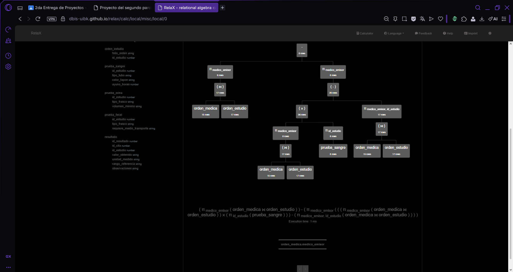
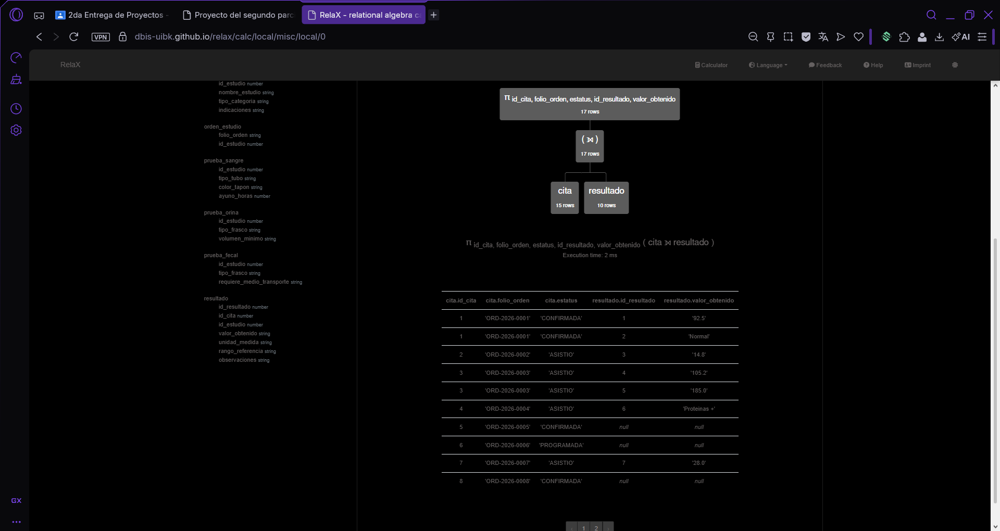
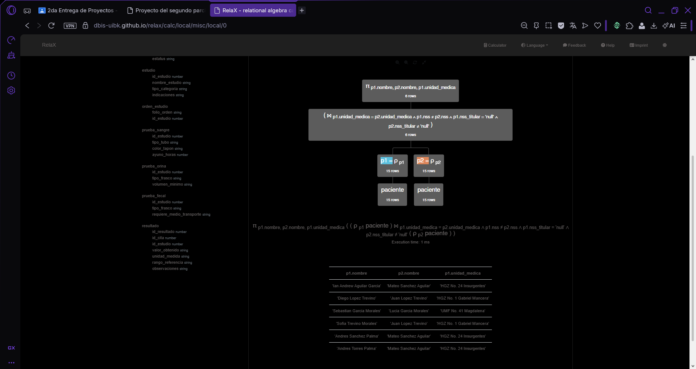

# Reporte de Trabajo Individual - Prácticas 6, 7 y 8
## Bases de Datos (ISC / IIA - ESCOM IPN)
**Alumno:** Ian Andrew Aguilar García  
**Usuario de GitHub:** `ZoulessAG`  
**Proyecto Propio:** Sistema de Citas Médicas y Laboratorio Clínico (*CitasMed*)  
**Fecha de Entrega:** 28 de Noviembre de 2026  

---

## 1. Consultas Propias en Álgebra Relacional

Las siguientes tres consultas son de autoría individual, no repiten las 13 consultas generales del equipo y abordan requerimientos clínicos operacionales específicos.

---

### Consulta Individual 1: División Relacional (÷)
* **Pregunta clínica del dominio:** ¿Qué médicos tratantes han prescrito TODOS los estudios clasificados como pruebas de sangre en sus órdenes médicas?
* **Justificación del operador:** Requiere el cuantificador universal («todos» los estudios hematológicos del catálogo).
* **Expresión formal en Álgebra Relacional:**
  Sean:
  $$R = \pi_{\text{medico\_emisor},\, \text{id\_estudio}}(\text{orden\_medica} \bowtie \text{orden\_estudio})$$
  $$S = \pi_{\text{id\_estudio}}(\text{prueba\_sangre})$$
  La división $R \div S$ se expresa en operadores relacionales primitivos como:
  $$\text{Medicos} \leftarrow \pi_{\text{medico\_emisor}}(R)$$
  $$\text{Faltantes} \leftarrow \pi_{\text{medico\_emisor}}((\text{Medicos} \times S) - R)$$
  $$\text{Resultado} = \text{Medicos} - \text{Faltantes}$$
* **Sintaxis compatible con RelaX:**
```text
(pi medico_emisor (orden_medica join orden_estudio)) - (
  pi medico_emisor (
    ((pi medico_emisor (orden_medica join orden_estudio)) cross join (pi id_estudio (prueba_sangre)))
    - (pi medico_emisor, id_estudio (orden_medica join orden_estudio))
  )
)
```
* **Captura de RelaX (Árbol y Resultado):**



* **Árbol Sintáctico Relacional:**
```text
                               - (División)
                      ┌─────────────┴─────────────┐
                      │                           │
              π (medico_emisor)           π (medico_emisor)
                      │                           │
               ⋈ (Natural Join)                   - (Faltantes)
              ┌───────┴───────┐          ┌────────┴────────┐
        orden_medica     orden_estudio   │                 │
                                         × (Cartesiano)   ⋈ (Prescripciones)
                                    ┌────┴────┐          ┌───┴───┐
                             π (medico)      π (id)    orden  estudio
                                    │           │
                               orden_medica  sangre
```
* **Consulta SQL Equivalente en PostgreSQL:**
```sql
SELECT DISTINCT o.medico_emisor
FROM orden_medica o
WHERE NOT EXISTS (
    SELECT ps.id_estudio
    FROM prueba_sangre ps
    EXCEPT
    SELECT oe.id_estudio
    FROM orden_medica om
    JOIN orden_estudio oe ON om.folio_orden = oe.folio_orden
    WHERE om.medico_emisor = o.medico_emisor
);
```
* **Análisis de comportamiento:** Compara el conjunto de pruebas hematológicas prescritas por cada médico con el catálogo total de `prueba_sangre`. Si un facultativo ha prescrito las 6 pruebas de sangre existentes, su nombre forma parte de la relación devuelta.

---

### Consulta Individual 2: Reunión Externa Izquierda (⟕)
* **Pregunta clínica del dominio:** ¿Cuáles son todas las citas registradas en el laboratorio y sus resultados emitidos, preservando aquellas citas que aún están programadas o pendientes de emisión de resultados?
* **Justificación del operador:** Demuestra la conservación de tuplas incompletas mediante la inyección de nulos en el lado derecho de la reunión.
* **Expresión formal en Álgebra Relacional:**
  $$\pi_{\text{cita.id\_cita},\, \text{folio\_orden},\, \text{estatus\_asistencia},\, \text{id\_resultado},\, \text{valor\_obtenido}}(\text{cita} \mathbin{⟕}_{\text{cita.id\_cita} = \text{resultado.id\_cita}} \text{resultado})$$
* **Sintaxis compatible con RelaX:**
```text
pi id_cita, folio_orden, estatus, id_resultado, valor_obtenido (
  cita left outer join resultado
)
```
* **Captura de RelaX (Árbol y Resultado):**



* **Árbol Sintáctico Relacional:**
```text
      π (id_cita, folio_orden, estatus, id_resultado, valor_obtenido)
                                     │
                            ⟕ (Left Outer Join)
                          ┌──────────┴──────────┐
                         cita               resultado
```
* **Consulta SQL Equivalente en PostgreSQL:**
```sql
SELECT c.id_cita, c.folio_orden, c.estatus_asistencia,
       r.id_resultado, COALESCE(r.valor_obtenido, 'PENDIENTE DE PROCESAR') AS valor_obtenido
FROM cita c
LEFT JOIN resultado r ON c.id_cita = r.id_cita;
```
* **Análisis de comportamiento:** En una reunión interna ($owtie$), las citas con estatus `'PROGRAMADA'` o citas recién tomadas en flebotomía que aún no son analizadas por los químicos de laboratorio desaparecerían del reporte. El operador $\mathbin{⟕}$ retiene la totalidad de citas del hospital, rellenando con `NULL` las columnas de resultados para las pruebas en proceso.

---

### Consulta Individual 3: Composición de Reunión Theta y Proyección (π ∘ ⋈_θ)
* **Pregunta clínica del dominio:** ¿Qué pares de derechohabientes distintos están adscritos a la misma clínica pero pertenecen a generaciones distintas (titular vs beneficiario)?
* **Justificación del operador:** Autoreunión (*Self-Join*) con condición compuesta de igualdad de clínica y desigualdad de claves primarias y jerarquía familiar.
* **Expresión formal en Álgebra Relacional:**
  $$T \leftarrow \rho_{\text{p1}}(\text{paciente}) \bowtie_{\text{p1.unidad = p2.unidad } \land \text{ p1.nss} \neq \text{p2.nss } \land \text{ p1.nss\_titular is null } \land \text{ p2.nss\_titular is not null}} \rho_{\text{p2}}(\text{paciente})$$
  $$\text{Resultado} = \pi_{\text{p1.nombre},\, \text{p2.nombre},\, \text{p1.unidad}}(T)$$
* **Sintaxis compatible con RelaX:**
```text
pi p1.nombre, p2.nombre, p1.unidad_medica (
  (rho p1 paciente) join p1.unidad_medica = p2.unidad_medica and p1.nss != p2.nss and p1.nss_titular = 'null' and p2.nss_titular != 'null' (rho p2 paciente)
)
```
* **Captura de RelaX (Árbol y Resultado):**



* **Consulta SQL Equivalente en PostgreSQL:**
```sql
SELECT p1.nombre AS titular, p2.nombre AS beneficiario, p1.unidad_medica_adscripcion AS unidad
FROM paciente p1
JOIN paciente p2 ON p1.unidad_medica_adscripcion = p2.unidad_medica_adscripcion
                AND p1.nss <> p2.nss
                AND p1.nss_titular IS NULL
                AND p2.nss_titular IS NOT NULL;
```
* **Análisis de comportamiento:** Permite auditar la concentración geográfica de derechohabientes por unidad médica, contrastando directamente a los cotizantes titulares frente a su población derechohabiente vinculada.

---

## 2. Explicación de la Descomposición Relacional (Parte 1) en Mis Propias Palabras

En la Parte 1 construimos deliberadamente una tabla desnormalizada llamada `recepcion_desnormalizada` que almacena en un solo renglón plano la información del paciente, la orden médica expedida, el estudio solicitado y el resultado analítico obtenido.

### ¿Por qué esta tabla era deficiente y violaba las formas normales?
La tabla `recepcion_desnormalizada` sufría de graves anomalías:
1. **Anomalía de redundancia y actualización:** Si un paciente tenía 5 estudios en una misma orden médica, su nombre completo y su clínica de adscripción se repetían idénticamente 5 veces. Si el paciente corregía su nombre, debíamos actualizar múltiples renglones. Si uno fallaba, el paciente quedaba con dos nombres distintos en la base de datos.
2. **Anomalía de inserción:** No podíamos dar de alta a un paciente nuevo en el sistema si todavía no tenía una orden médica o un resultado de laboratorio generado.
3. **Violación de 2FN y 3FN:** La clave primaria conceptual de esa tabla combinada era `(folio_orden, id_estudio)`. Atributos como `nombre_paciente` dependían únicamente de `nss` (dependencia transitiva a través de `folio_orden`), violando la 3FN y BCNF.

### La Solución: Descomposición en 4 Tablas Normalizadas
Descompusimos la relación plana en cuatro tablas en Forma Normal de Boyce-Codd (BCNF):
* `norm_paciente(nss, nombre, unidad_medica)`: Donde `nss` es clave primaria y determina unívocamente a `nombre` y `unidad_medica`.
* `norm_estudio(id_estudio, nombre_estudio, tipo_categoria)`: Donde `id_estudio` es clave primaria y determina la descripción y clasificación de la prueba.
* `norm_orden_medica(folio_orden, fecha_cita_medico, medico_emisor, nss_paciente)`: Donde `folio_orden` es clave primaria y propaga `nss_paciente` como clave foránea.
* `norm_resultado(id_resultado, folio_orden, id_estudio, valor_obtenido, unidad_medida)`: Donde cada resultado atómico referencia a la orden y al estudio respectivo.

### ¿Por qué esta descomposición es correcta? (Reunión sin pérdida y preservación)
1. **Reunión sin pérdida (*Lossless Join*):** Al reunir las tablas mediante la intersección de sus atributos comunes:
   $$\text{norm\_paciente} \cap \text{norm\_orden\_medica} = \{\text{nss}\}$$
   Como `nss` es la clave primaria de `norm_paciente`, el Teorema de Reunión sin Pérdida garantiza que el `NATURAL JOIN` produce exactamente las tuplas originales, sin generar registros espurios o fantasma.
2. **Preservación de dependencias funcionales:** Todas las dependencias del negocio ($NSS \rightarrow \text{Nombre}$, $\text{Folio} \rightarrow \text{Fecha, Médico, NSS}$, $\text{IdEstudio} \rightarrow \text{Nombre, Categoría}$) quedaron contenidas enteramente dentro de sus respectivas tablas individuales, por lo que el gestor puede validar cualquier restricción de integridad mediante índices `PRIMARY KEY` y `FOREIGN KEY` sin necesidad de ejecutar costosos `JOIN` previos.

---
**Firma:** Ian Andrew Aguilar García (`ZoulessAG`)  
Estudiante de Ingeniería en Sistemas Computacionales - ESCOM IPN
